# Zynq与AD9361扩频收发系统及上位机设计

本项目基于 Zynq-7020 与 AD9361 构建扩频收发系统，将数字基带处理、射频收发、业务传输和 Qt 上位机监测集成在同一套实验平台中。FPGA 可编程逻辑承担实时基带运算，处理器系统负责 AD9361 配置、DDR 与 DMA 管理和 TCP 通信，Qt 上位机完成业务数据下发、监测数据解析、频谱计算和结果保存。

发射链完成业务装载、加扰、组帧、直接序列扩频、PSK 映射和成形处理；接收链完成采样预处理、PMF-FFT 捕获、载波与码跟踪、同步判决和解扰。系统同时回传接收 I/Q、解调结果、发射端扩频前参考和成功捕获功率窗口，使基带处理状态能够通过上位机进行关联观察。

## 主要功能

- AD9361 2R2T LVDS 数字收发接口
- 直接序列扩频与 PN 码生成
- BPSK、QPSK、OQPSK 映射，当前系统配置使用 QPSK
- 基于分段相关和共享 FFT 的 PMF-FFT 捕获
- 载波环与码环协同跟踪
- 数字下变频、E/P/L 相关与相干积分
- AXI4-Stream 与 AXI DMA 数据传输
- TCP 5001 监测回传和 TCP 5002 业务下发
- Qt I/Q 波形、星座图、频谱、捕获窗口和解调数据展示
- 原始数据、CSV 和文本结果保存

## 系统总体架构

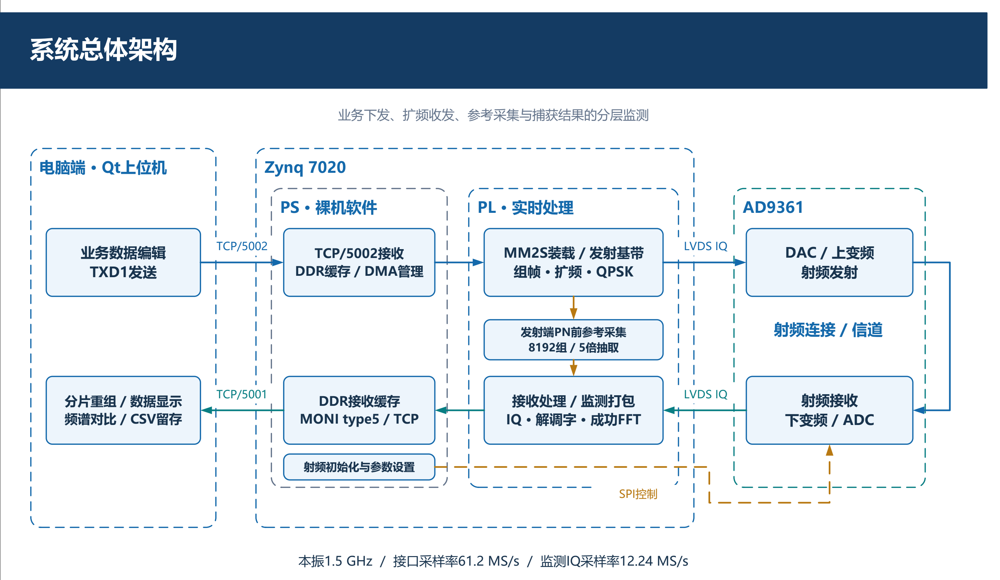

系统由电脑端 Qt 上位机、Zynq 处理器系统、FPGA 可编程逻辑和 AD9361 射频前端组成。

| 组成部分 | 主要职责 |
|---|---|
| Qt 上位机 | 业务数据编辑与发送、监测数据接收、频谱计算、波形显示和结果保存 |
| Zynq PS | AD9361 初始化与参数配置、DDR 缓存、DMA 管理和 TCP 协议处理 |
| Zynq PL | 扩频调制、捕获、跟踪、同步判决及监测数据组帧 |
| AD9361 | 数字 I/Q 与射频信号转换，提供可配置本振、带宽和增益 |

AD9361 LVDS 接口具备 2R2T 数据能力。当前接收算法链主要使用通道 1 的 I/Q 数据，第二路保留在接口与测试路径中。

### 硬件平台

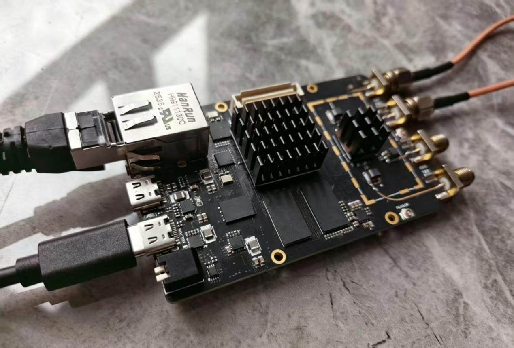

## 主要配置

| 参数 | 当前配置 |
|---|---:|
| FPGA/SoC | Zynq-7020 XC7Z020CLG400-1 |
| 射频收发器 | AD9361 |
| 收发本振频率 | 1.5 GHz |
| 参考时钟 | 40 MHz |
| LVDS 接口采样率 | 61.2 MS/s |
| 射频配置带宽 | 20 MHz |
| 接收增益 | 21 dB |
| 发射衰减 | 20 dB |
| 捕获与监测支路有效采样率 | 12.24 MS/s |
| PN 码片速率 | 4.08 Mchip/s |
| 捕获相干积分窗口 | 250 us |
| 每段相关积分长度 | 612 个采样点 |
| 每个码相位的分段相关结果 | 5 个复数结果 |
| 捕获 FFT 长度 | 128 点 |
| Qt 显示刷新周期 | 约 100 ms |

这些数值是当前工程配置，用于说明系统工作方式。误码率、灵敏度、吞吐率等指标应以相应测试条件下的测量结果为准。

## 收发信号流程

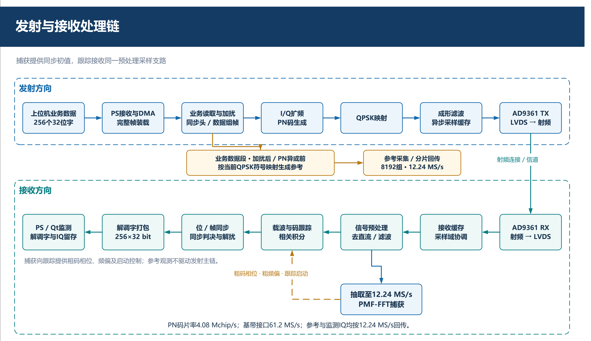

### 发射链

上位机通过 TCP 5002 提交业务数据，处理器将 256 个 32 位数据字保存到 DDR，并通过 AXI DMA MM2S 通道装载到 FPGA。FPGA 完成数据读取、加扰、同步头与数据段组帧、PN 扩频、QPSK 映射和成形滤波，随后通过 AD9361 LVDS 接口送入射频发射链。

当前帧结构的主要参数如下：

| 项目 | 配置 |
|---|---:|
| 单帧业务载荷 | 256 x 32 bit，1024 B |
| 同步头长度 | 112 bit |
| 同步头每位码片数 | 1020 |
| 数据段符号数 | 4096 个 I/Q 符号 |
| 数据段每符号码片数 | 51 |
| 同步头持续时间 | 约 28 ms |
| 数据段持续时间 | 约 51.2 ms |
| 理想单帧时长 | 约 79.2 ms |
| QPSK 数据段符号率 | 80 ksymbol/s |

当前工程的 LDPC 编码处于旁路状态。发射监测支路从业务数据加扰后、PN 异或前的位置采集 8192 组 I/Q 参考，并按分片方式回传，用于观察扩频前后的频谱形态。

### 接收链

AD9361 输出的 I/Q 数据首先经过直流抑制、滤波和功率检测。预处理结果进入两个处理支路：捕获支路使用 12.24 MS/s 抽取数据搜索码相位和载波频偏；跟踪支路使用 61.2 MS/s 预处理数据，根据捕获结果初始化本地载波和码 NCO，并持续修正同步误差。

捕获向跟踪交接粗码相位、粗频偏和启动控制。载波环与码环建立同步后，及时支路结果进入帧同步、判决与解扰处理，形成业务输出。

## PMF-FFT 捕获

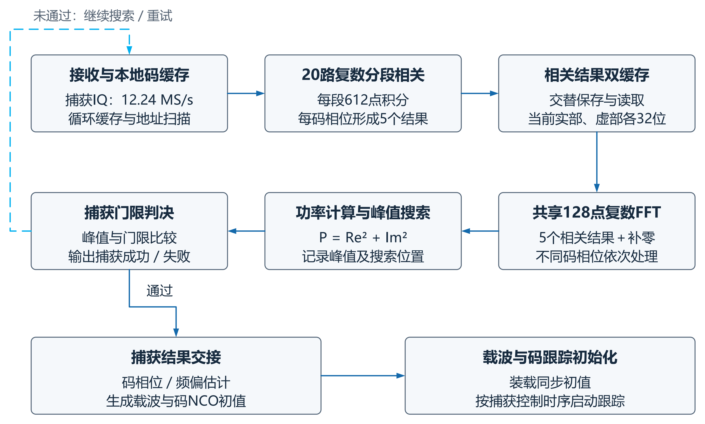

捕获模块采用 20 路复数分段相关通道并行计算不同码相位，每段积分 612 个采样点，每个候选码相位形成 5 个复数相关结果。相关结果补零后送入共享 128 点复数 FFT，通过频域搜索获得峰值位置、粗码相位和粗频偏估计。

实现中采用循环采样缓存和相关结果双缓存。采样写入、相关读取和 FFT 处理按批次交替进行，不同码相位通过时间调度复用同一个 FFT 核。峰值通过门限判断后，控制逻辑生成载波与码 NCO 初值，并按照捕获控制时序启动跟踪。

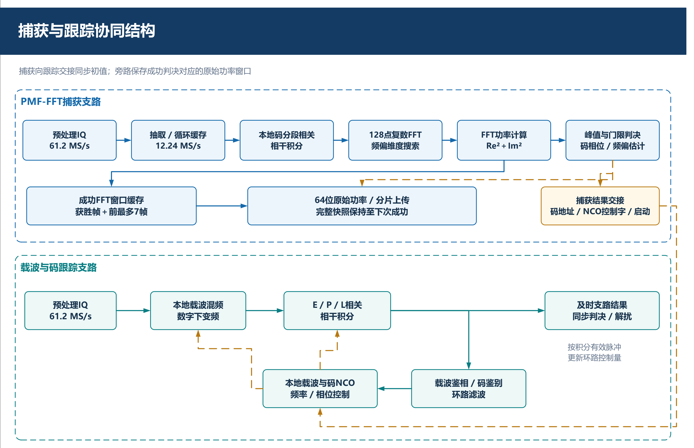

系统保留产生获胜峰值的完整 FFT 功率帧及其前序完整帧。每帧包含 128 个原始功率点，最多保存 8 帧，形成 1024 点成功捕获观察窗口。该窗口用于记录捕获事件，不代表算法使用 1024 点 FFT。

## 载波与码跟踪

跟踪支路使用预处理后的 61.2 MS/s I/Q 数据。本地载波与输入信号混频完成数字下变频，再分别与超前、及时和滞后本地码进行相关积分，形成 E、P、L 三路结果。

- 载波环根据及时支路相关结果提取相位误差，经环路滤波生成载波 NCO 控制量。
- 码环比较超前与滞后支路的相关幅度，经码环滤波调节码 NCO。
- 及时支路用于载波误差提取、同步判决和业务数据恢复。
- 环路控制量在相干积分结果有效时更新。

捕获和跟踪通过统一的码地址、载波控制字和启动时刻完成交接，同时补偿缓存、滤波器和流水线延迟。

## 监测数据与网络协议

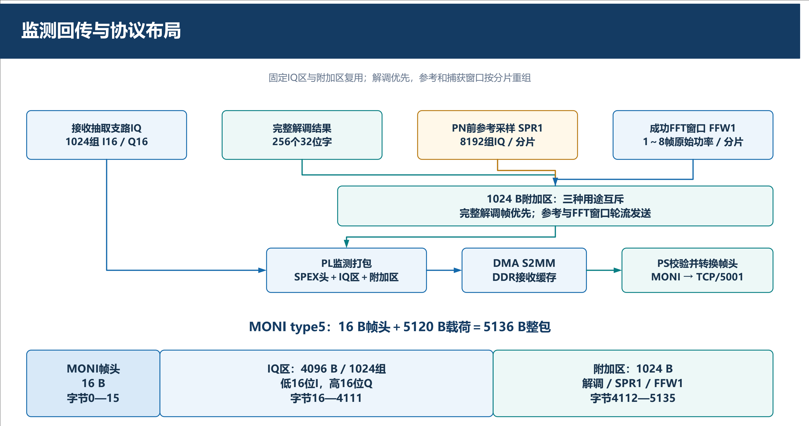

系统使用两条独立 TCP 连接：

| 端口 | 连接方式 | 作用 |
|---:|---|---|
| 5001 | 电脑作为 Server，板卡主动连接 | MONI 监测数据回传 |
| 5002 | 板卡作为 Server，上位机主动连接 | TXD1 业务下发与 TXA1 回执 |

默认网络配置：

```text
Board IP: 192.168.1.10
PC IP:    192.168.1.209
Netmask:  255.255.255.0
```

### TXD1 与 TXA1

- TXD1 请求由 12 B 帧头和 1024 B 业务载荷组成。
- 业务载荷包含 256 个小端 32 位数据字。
- TXA1 回执用于确认业务帧的接收与 PL 提交结果。
- 循环发送在收到上一帧成功回执后继续。

### MONI type 5

MONI type 5 完整网络帧为 5136 B，由 16 B 帧头和 5120 B 载荷组成。

| 区域 | 长度 | 内容 |
|---|---:|---|
| MONI 帧头 | 16 B | 类型、长度、标志和序号等字段 |
| I/Q 区 | 4096 B | 1024 组 I16/Q16 接收采样 |
| 附加区 | 1024 B | 解调数据、SPR1 参考或 FFW1 捕获窗口分片 |

帧头多字节字段使用网络字节序，载荷保持小端格式。每个 I/Q 字的低 16 位为有符号 I，高 16 位为有符号 Q。附加区的三类数据互斥使用，完整解调结果优先发送，参考数据和捕获功率窗口按分片重组。

## Qt 上位机

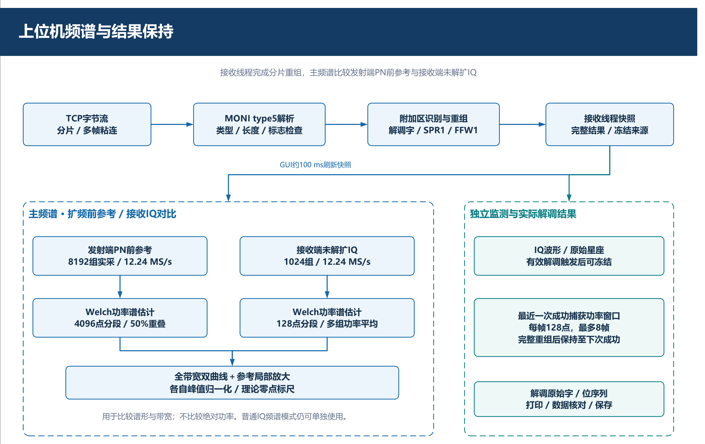

Qt 上位机在接收线程中完成 TCP 字节流组帧、MONI 解析和辅助分片重组，界面周期性读取接收快照。接收 I/Q、解调结果、扩频前参考和成功捕获窗口按照各自的数据来源与更新条件独立管理。

主要功能包括：

- 业务数据编辑、文件载入和 TXD1 发送
- TXA1 序号匹配与发送状态管理
- I/Q 时域波形与原始星座图显示
- 解调原始字、位序列和数据核对
- 发射端扩频前参考与接收 I/Q 频谱比较
- 最近一次成功捕获功率窗口保持
- 原始数据、CSV 和文本结果保存
- TCP 分包、粘包、超时及序号跳变统计

### 业务发送与波形显示

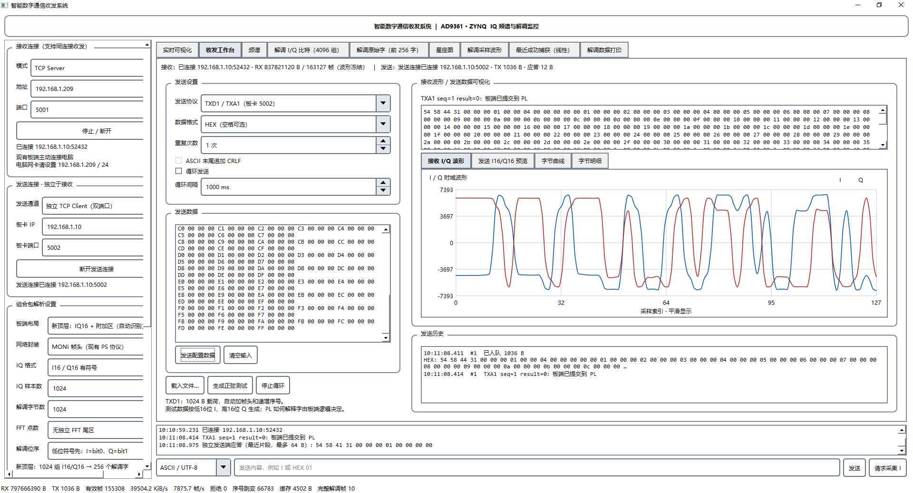

### 频谱显示

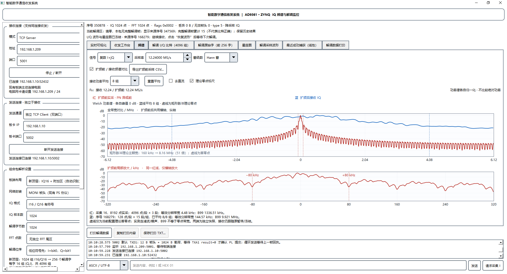

主频谱页面比较发射端 PN 异或前参考与接收端尚未解扩的 I/Q。参考数据使用 4096 点分段，接收 I/Q 使用 128 点分段，两者均采用 50% 重叠的 Welch 功率谱估计。接收曲线进一步对多组快照进行线性功率平均。

两条频谱曲线分别按峰值归一化，用于比较谱形和带宽，不用于比较绝对功率，也不表示同一接收信号解扩前后的对比。

### 成功捕获窗口

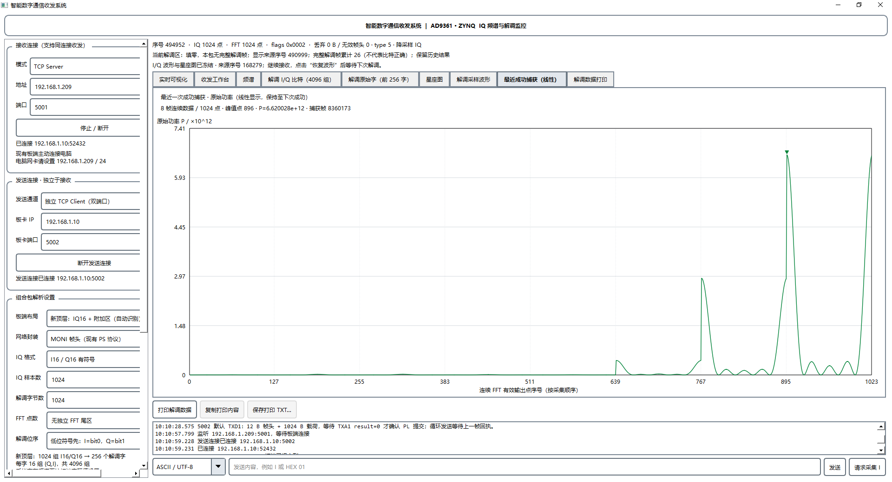

上位机在收到全部捕获分片后统一更新功率窗口，并保持到下一次完整成功结果到达。横轴表示连续有效输出点序号，峰值位置用于关联具体捕获事件。

## 工程实现与测试

### Vivado 系统设计

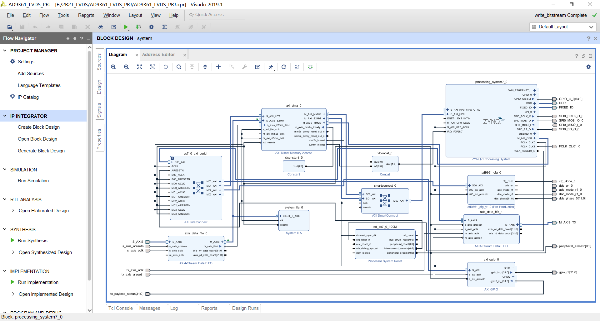

工程使用 Vivado 2019.1，处理器系统通过 AXI DMA、AXI Interconnect、AXI4-Stream FIFO 和自定义 AD9361 配置接口与 FPGA 数据通路连接。

### 仿真波形

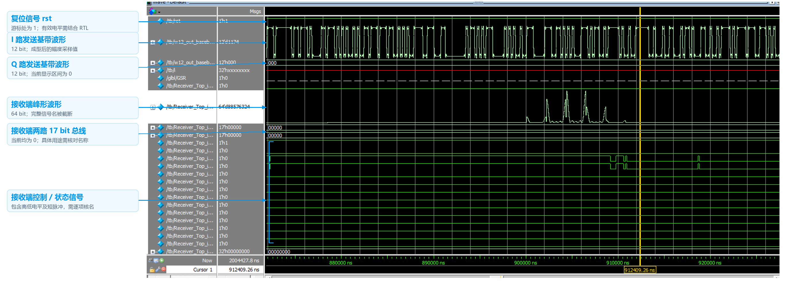

### 射频输出观察

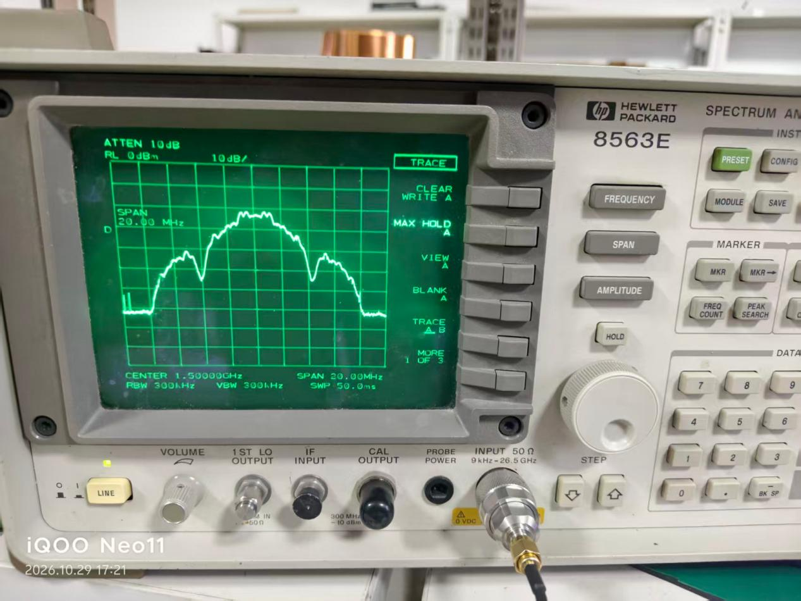

频谱仪设置图中可见中心频率为 1.5 GHz、跨度为 20 MHz，用于观察实际射频输出频谱。

## 资源复用设计

PMF-FFT 捕获在 20 路复数相关通道后共享一个 FFT 核，不为每个码相位配置独立 FFT。相关运算利用 PN 码的二值特性，以受码序列控制的加减累加代替通用乘码操作。相关结果缓存将实部和虚部从 32 bit 调整为 26 bit，并在读出时恢复符号扩展。

| 对比项目 | 独立 FFT 基线 | 共享 FFT 设计 |
|---|---:|---:|
| 复数相关通道 | 20 | 20 |
| FFT 核数量 | 20 | 1 |
| FFT 长度 | 128 点 | 128 点 |
| 每个复数缓存字 | 64 bit | 52 bit |
| 两组相关结果逻辑存储 | 12800 bit | 10400 bit |

共享结构将 FFT 实例数从 20 个减少为 1 个；按相同 FFT 实例线性比较，FFT 部分的 LUT、寄存器、BRAM 和 DSP 需求约减少 95%。相关结果逻辑存储量减少 2400 bit，约为 18.75%。这些数值描述 FFT 部分的结构对比，不等同于整个系统资源减少比例。

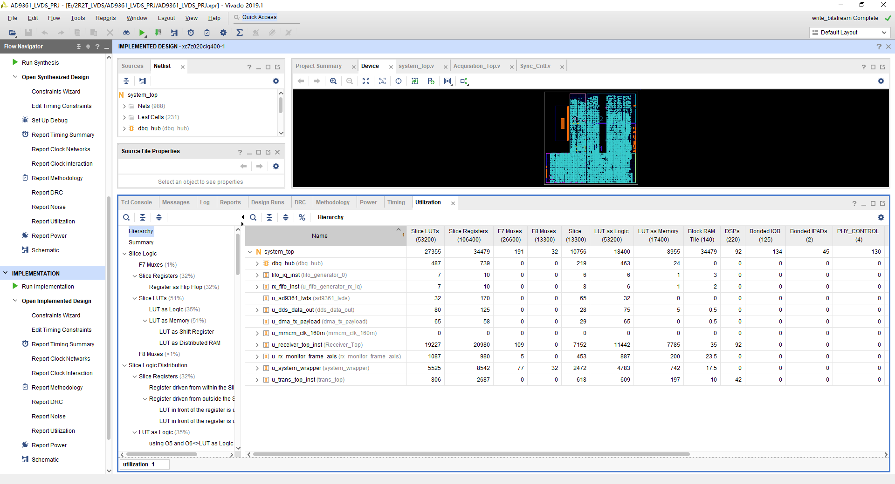

## 源码目录

```text
.
|-- README.md
|-- LICENSE
|-- src/
|   |-- rtl/
|   |   |-- interface/
|   |   |-- acquisition/
|   |   |-- modulation/
|   |   |-- carrier_tracking/
|   |   |-- code_tracking/
|   |   `-- demod_sync/
|   `-- qt/
|-- sim/
|-- build/
|-- board/
|-- data/
|-- skill/
`-- report/
```

| 目录 | 内容 |
|---|---|
| `src/rtl/interface` | AD9361 LVDS 接口 |
| `src/rtl/acquisition` | 捕获缓存、降采样、相干积分和峰值检测 |
| `src/rtl/modulation` | PN 码生成、扰码和 PSK 映射 |
| `src/rtl/carrier_tracking` | 载波环滤波 |
| `src/rtl/code_tracking` | 码环滤波 |
| `src/rtl/demod_sync` | DDC、相干积分和 AXI 解调输出 |
| `src/qt` | Qt TCP 上位机源码 |
| `sim` | Qt 协议测试和模拟板卡工具 |
| `board` | 板级约束和硬件说明 |
| `report` | 系统报告、图片和协作记录 |


## 软件环境

- Vivado 2019.1
- Qt 5.x，C++17
- Python 3.x，用于测试数据生成和模拟板卡

使用 Qt Creator 打开 `src/qt/tcp.pro` 可以查看上位机工程。协议测试位于 `sim/qt`，模拟板卡和测试数据生成工具位于 `sim/tools`。

## 参考资料

1. R. C. Dixon, *Spread Spectrum Systems with Commercial Applications*, 3rd ed., Wiley, 1994.
2. F. M. Gardner, *Phaselock Techniques*, 3rd ed., Wiley, 2005.
3. J. W. Cooley and J. W. Tukey, "An algorithm for the machine calculation of complex Fourier series," *Mathematics of Computation*, 1965.
4. D. J. R. van Nee and A. J. R. M. Coenen, "New fast GPS code-acquisition technique using FFT," *Electronics Letters*, 1991.
5. D. Akopian, "Fast FFT based GPS satellite acquisition methods," *IEE Proceedings Radar Sonar and Navigation*, 2005.
