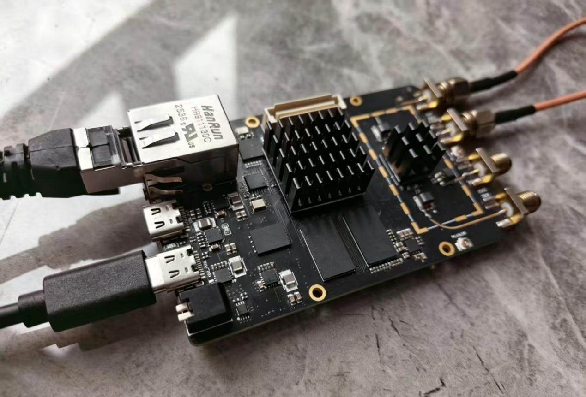
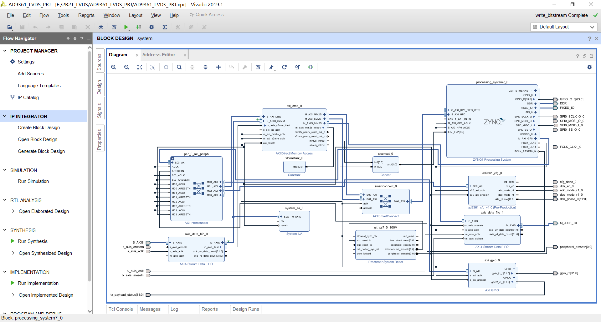
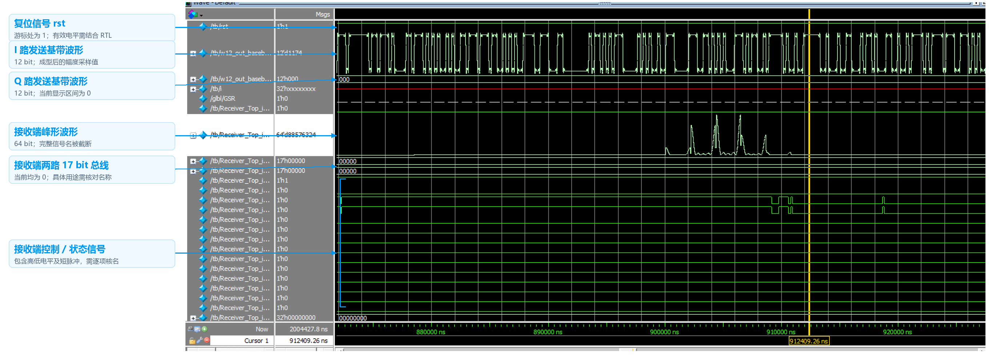
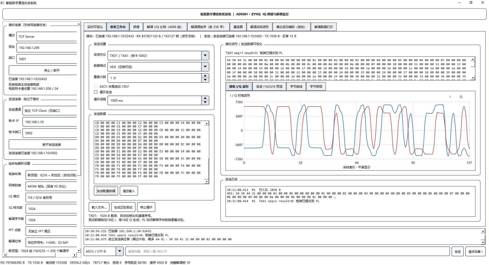
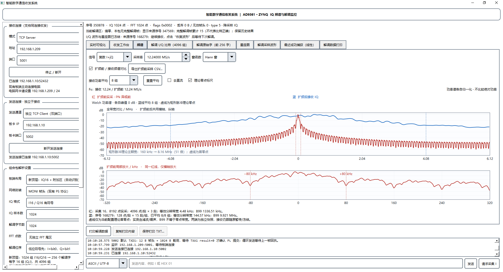
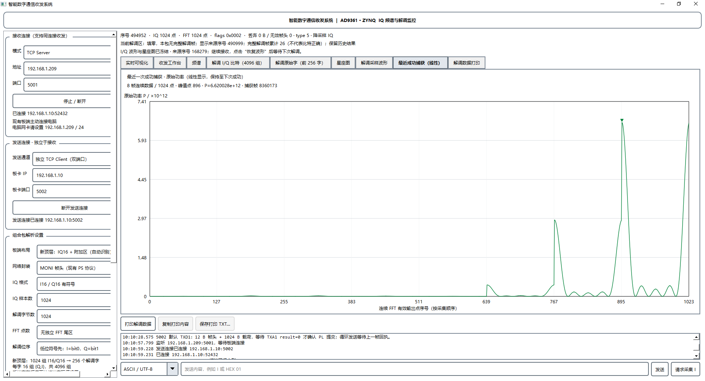
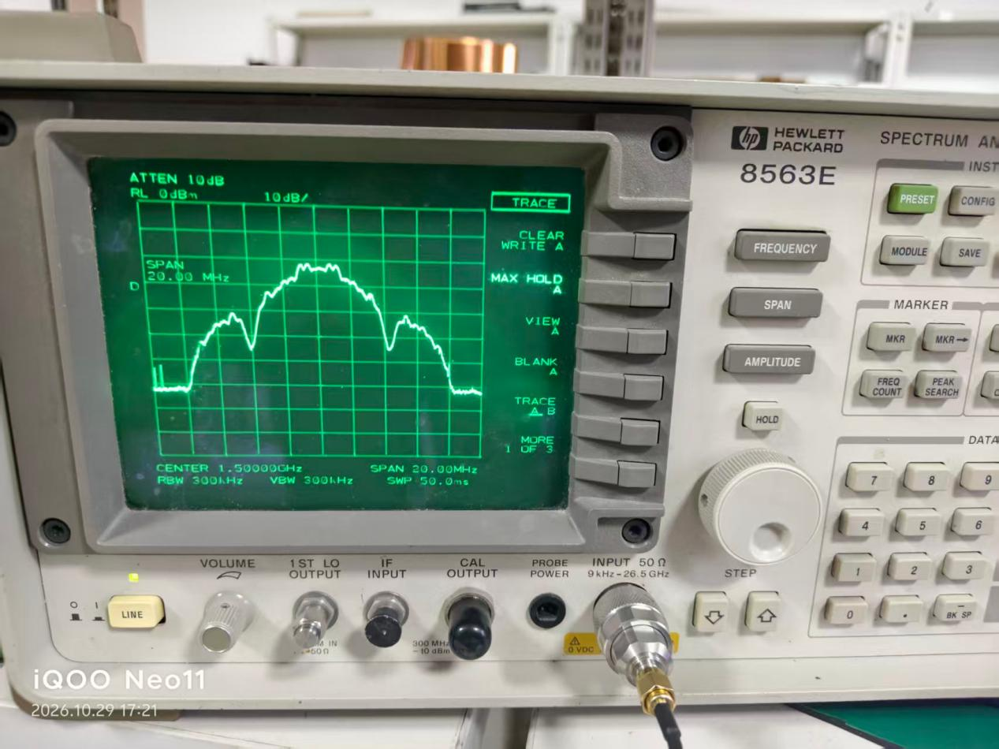
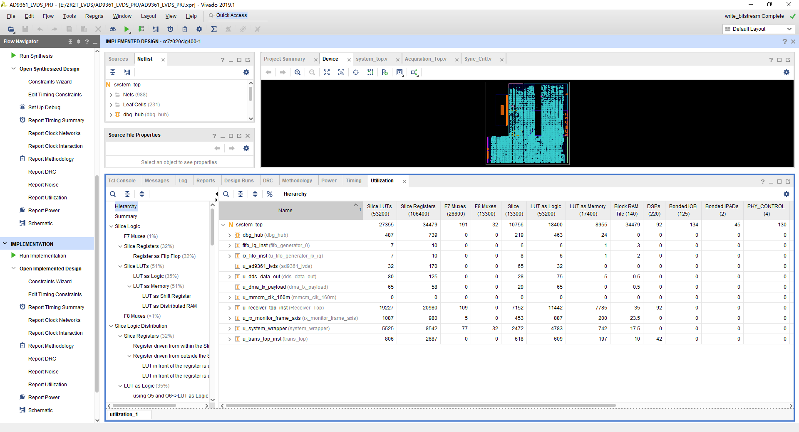
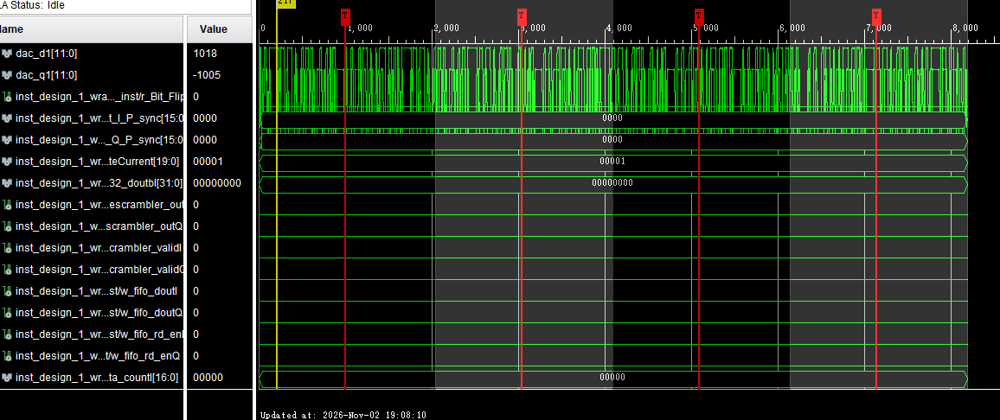

# Data and Results

本目录保存系统实现、仿真、上位机显示、射频测量和 FPGA 资源利用等典型结果。图片用于说明工程已经完成的功能及测试现象；涉及带宽、功率、误码率或捕获概率等定量结论时，应结合原始数据和测试条件进一步计算，不能只依据截图判断。

## 结果图索引

| 文件 | 类型 | 说明 |
|---|---|---|
| `results/hardware_platform.jpeg` | 硬件平台 | Zynq 与 AD9361 一体化板卡、以太网连接及射频连接实物 |
| `results/vivado_block_design.png` | 工程结构 | Vivado 中 Zynq PS、AXI DMA、FIFO、GPIO 与 AD9361 配置模块连接关系 |
| `results/simulation_waveform.png` | RTL 仿真 | 发射基带、接收端峰形和接收控制状态的仿真观察结果 |
| `results/qt_transceiver.png` | 上位机联调 | TCP 5001 监测接收、TCP 5002 业务发送及 TXD1/TXA1 回执状态 |
| `results/qt_spectrum.png` | 频谱分析 | 发射端扩频前参考与接收端扩频 I/Q 的 Welch 功率谱对比 |
| `results/qt_capture_window.png` | 捕获结果 | 最近一次成功捕获对应的连续 FFT 功率窗口 |
| `results/spectrum_analyzer.jpeg` | 射频测量 | 频谱仪观察到的 1.5 GHz 附近射频输出频谱 |
| `results/resource_utilization.png` | 实现结果 | Vivado 实现后各层级模块的 LUT、寄存器、BRAM 和 DSP 占用 |
| `results/transmitter_signal.png` | ILA 在线观测 | 发射 DAC I/Q、同步结果及相关数据通路信号 |
| `results/transmitter_jamming signal.png` | ILA 在线观测 | 扰码相关输出、有效标志及相关积分控制信号的时序 |

## 1 硬件平台

实物图展示了系统使用的 Zynq 与 AD9361 一体化硬件平台。板卡通过以太网与电脑上位机通信，射频端口通过同轴线连接，用于发射与接收链路的联合调试。该图片用于说明系统测试所依赖的硬件环境和物理连接方式。

## 2 Vivado 系统块设计

块设计图展示了 Zynq Processing System、AXI DMA、AXI Interconnect、AXI SmartConnect、AXI4-Stream FIFO、AXI GPIO、系统复位和 AD9361 配置模块之间的连接。PS 负责 DDR、以太网和控制管理，DMA 与 FIFO 用于在 PS 存储空间和 PL 流式数据通路之间搬移数据。

## 3 RTL 仿真波形

仿真图同时观察复位、I/Q 发射基带、接收端峰形及接收控制状态。发射波形用于检查基带样值输出，接收峰形用于观察相关或功率结果随处理过程的变化，控制信号用于核对各阶段的有效状态与时序关系。图中的部分总线处于零值或未展开状态，因此判断具体功能时还需结合对应信号名称和测试激励。

## 4 Qt 收发联调界面

界面显示了两条相互独立的网络连接：电脑在 TCP 5001 端口接收板卡监测数据，同时通过 TCP 5002 向板卡发送业务数据。图中可以看到 TXD1 帧发送、TXA1 回执、发送内容、接收 I/Q 波形及运行日志，用于检查数据装载、网络连接和板端提交状态。

## 5 扩频前参考与接收频谱

红色曲线表示发射端 PN 异或前参考，蓝色曲线表示接收端仍处于扩频状态的 I/Q。两条曲线分别通过 Welch 方法估计并按各自峰值归一化，主要用于观察谱形和带宽差异，不能用于比较两者的绝对功率。下方局部视图用于放大发射参考的窄带频谱结构。

## 6 成功捕获功率窗口

该页面显示最近一次成功捕获对应的 FFT 原始功率。图中窗口由 8 帧连续结果组成，每帧 128 点，共 1024 个有效输出点。横轴表示按采集顺序连接后的 FFT 有效点序号，不代表算法采用 1024 点 FFT；实际捕获仍使用 128 点 FFT。窗口在下一次完整成功捕获结果到来前保持显示。

## 7 频谱仪射频测量

频谱仪中心频率设置在 1.5 GHz，跨度为 20 MHz，用于观察实际射频输出的频谱形态。该结果能够与上位机显示的基带频谱相互参照，但仪器曲线还受到分辨率带宽、视频带宽、衰减、保持方式和连接损耗影响，因此进行功率或带宽定量比较时需要同时记录完整仪器配置。

## 8 FPGA 资源利用情况

Vivado 实现结果给出了顶层及各层级模块的 Slice LUT、Slice Register、BRAM Tile 和 DSP 使用情况。图中可用于观察接收处理、监测打包、系统封装和发射处理等模块的资源分布，并与设计报告中的共享 FFT 和缓存位宽优化结果相互核对。资源百分比应以当前目标器件、IP 配置和实现版本为准。

## 9 ILA 发射 I/Q 与数据通路观测

该截图观察 `dac_d1[11:0]`、`dac_q1[11:0]` 以及同步结果、扰码相关输出和 FIFO 读使能等信号。窗口上方可以看到两路 DAC 数据的变化，下方信号用于关联同步与业务数据通路的工作状态。分析时应结合数据有效标志和实际抓取区间，检查样值输出与后续处理时序。

## 10 ILA 扰码相关输出与有效时序

该截图重点展示扰码相关数据输出及其有效标志，同时保留 PN 切换、积分脉冲、相关结果和读出控制等信号，便于核对数字序列变化与控制时序。图中可以看到两路数据输出翻转及相应有效信号拉高的过程。文件名中的 `jamming signal` 对应本次保存的截图名称，此图用于数字数据通路观测，不表示进行了外部射频干扰测试。
