# Zynq与AD9361扩频收发系统设计报告

本系统面向扩频无线链路的工程实现与联合调试需求，以 Zynq 7020 为数字处理与控制平台，以 AD9361 完成射频收发，并配套 Qt 上位机实现业务下发、监测数据解析、频谱显示和结果保存。设计重点不只在于实现单个通信算法，还在于解决射频、实时基带、处理器软件和上位机之间的参数一致性、捕获与跟踪交接以及内部状态可观察性问题。

## 1 选题背景与创新点

### 1.1 选题背景

扩频通信通过伪随机序列展宽信号频谱，具有较好的抗窄带干扰、低功率谱密度和多址扩展能力，适用于无线数据传输、遥测回传和远程信息采集等场景。但扩频信号在接收端必须先解决码相位和载波频偏未知的问题，才能进入持续跟踪、帧同步和数据恢复。相比一般的调制解调链路，扩频接收机对采样时序、相关积分、频偏搜索以及环路控制的配合要求更高。

工程实现中主要存在四类实际问题。第一，AD9361 输出的是连续高速 I/Q 采样，捕获、跟踪和调制处理必须满足固定的数据节拍，单纯依靠处理器难以保证实时性。第二，射频参数配置、DDR 缓存、DMA 和网络通信具有明显的软件控制特征，全部放在 FPGA 中会增加开发和维护复杂度。第三，捕获输出的粗码相位和粗频偏必须在正确的采样时刻装载到载波与码跟踪环路，若没有补偿缓存、滤波和流水线延迟，即使捕获峰值正确，跟踪仍可能快速失锁。第四，接收 I/Q、捕获功率、扩频前参考和解调数据来自不同处理节点，若缺少统一的监测协议和来源标识，调试人员难以判断异常发生在射频、基带还是网络环节。

因此，本项目选择 Zynq 与 AD9361 组合平台，将 FPGA 并行处理、ARM 端控制管理和 Qt 可视化监测结合起来，形成从业务数据输入、扩频调制、射频收发、PMF-FFT 捕获、载波与码跟踪到解调结果回传的完整工程链路。

### 1.2 相关技术基础

已有直接序列扩频接收机通常采用滑动相关、匹配滤波或频域相关完成码相位搜索，并通过载波环和码环维持同步。串行滑动相关结构资源需求较低，但搜索时间随候选码相位和频偏数量增加；完全并行的匹配滤波结构搜索速度快，但会消耗大量逻辑和存储资源。FFT 捕获方法将频偏搜索转化为频域峰值搜索，能够提高搜索效率；PMF-FFT 进一步利用分段匹配滤波与 FFT 组合，在码相位覆盖、频偏分辨率和硬件规模之间进行折中。

前人工作已经建立了扩频相关检测、FFT 快速捕获以及锁相环和延迟锁定环的理论基础。现有研究也提出了多种 PMF-FFT 快速捕获与计算简化方法。本项目在这些方法基础上，重点解决算法在 Zynq、AD9361 和上位机系统中的接口实现、资源复用、捕获跟踪交接和监测验证问题。

### 1.3 主要创新点

本项目的创新主要体现在已有扩频通信算法的 FPGA 结构优化、捕获与跟踪协同，以及软硬件一体化工程实现三个方面。

1. 面向 FPGA 的并行 PMF-FFT 联合捕获结构

系统采用分段匹配滤波与快速傅里叶变换相结合的 PMF-FFT 捕获方法，对扩频信号的码相位和载波频偏进行二维联合搜索。硬件结构设置 20 路复数分段相关通道，并通过双缓存调度使不同码相位分时复用同一个 128 点 FFT 核；同时利用 PN 码的二值特性，以加减累加代替通用乘法，并根据相关积分范围压缩缓存位宽。相较于为每路相关通道分别配置 FFT 核的等效基线，该结构在保持 20 路相关并行度和 128 点频域搜索规格的同时，将 FFT 核数量由 20 个减少为 1 个，FFT 部分资源估算减少约 95%，相关结果缓存量减少约 18.75%。

2. 捕获—跟踪同步交接及 DLL/FLL/PLL 联合跟踪

捕获模块不仅输出相关峰值，还给出粗码相位、粗载波频偏和有效启动时刻。控制逻辑结合缓存、相关积分和流水线处理延迟，对捕获结果进行时序补偿，并同步初始化载波 NCO 和码 NCO，减少捕获成功后因控制量装载不同步而发生失锁的可能。在跟踪阶段，DLL 利用超前、及时和滞后相关结果修正码定时误差；FLL 用于校正较大的残余频率偏差；PLL 进一步完成载波相位精细跟踪，从而实现由粗捕获到稳定同步的连续处理。

3. 基于 ZYNQ、AD9361 与 Qt 的软硬件协同实现

系统根据任务实时性和控制复杂度进行分层设计：Zynq PL 负责扩频调制、PMF-FFT 捕获、载波与码跟踪、同步判决等连续高速基带处理；Zynq PS 负责 AD9361 参数配置、DDR 缓存、DMA 调度和 TCP 网络通信；Qt 上位机负责业务数据下发、监测帧重组、波形及频谱显示和结果保存。系统通过 LVDS、AXI4-Stream、AXI DMA、DDR 和双 TCP 连接建立完整数据链路，并对接收 I/Q、解调数据、扩频前参考和捕获功率窗口进行分类回传，提高了系统联调、状态观察和故障定位能

## 2 设计原理与功能框图

### 2.1 系统总体结构

系统由 Qt 上位机、Zynq 7020 和 AD9361 三部分组成。Zynq 内部进一步划分为处理器系统 PS 和可编程逻辑 PL：PS 负责网络通信、DDR 缓存、DMA 管理以及 AD9361 参数配置，PL 负责受采样节拍约束的实时基带处理，AD9361 负责数字 I/Q 与射频信号之间的转换。该结构把人机交互、系统控制、实时运算和射频收发分别安排在适合的平台上。

发射方向由上位机通过 TCP 5002 下发业务数据，PS 接收完整数据后写入 DDR，并通过 DMA 装载到 PL。PL 完成业务读取、组帧、加扰、扩频、QPSK 映射和成形处理，再通过 LVDS 将发射 I/Q 送入 AD9361，由其完成数模转换和射频发射。

接收方向由 AD9361 完成射频接收、下变频和模数转换，接收 I/Q 通过 LVDS 进入 PL。PL 依次完成信号预处理、PMF-FFT 捕获、载波与码跟踪、帧同步及解调判决。接收 I/Q、解调结果、扩频前参考和成功捕获功率窗口由监测支路分别缓存，经 DMA 写入 DDR，再由 PS 通过 TCP 5001 回传上位机，用于波形显示、频谱分析、捕获结果观察和业务数据核对。监测支路只提取处理结果，不参与发射控制、捕获判决和跟踪反馈。

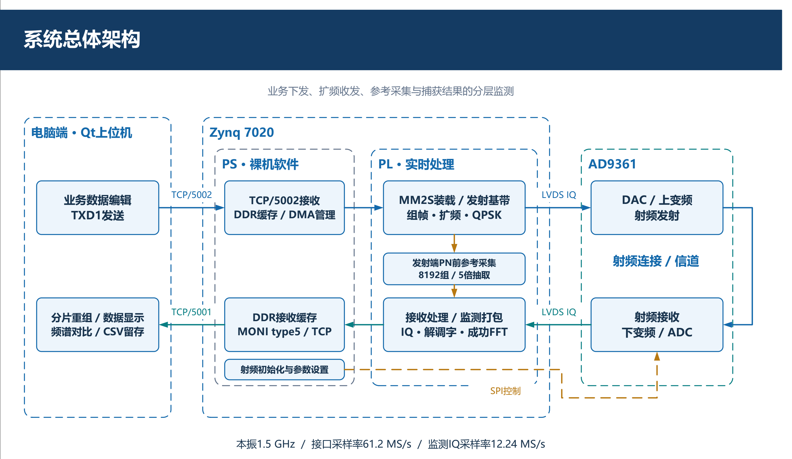

### 2.2 收发与监测数据流

系统的数据主链以发射和接收两个方向组织，监测链从关键节点旁路取数。发射方向从业务帧装载开始，经组帧、扩频、调制和成形后进入 AD9361；接收方向从 AD9361 采样开始，经预处理、捕获、跟踪和同步判决形成恢复数据。捕获支路与跟踪支路共享预处理采样来源，但二者不是前后串接的数据滤波链，捕获结果仅用于初始化跟踪控制量。

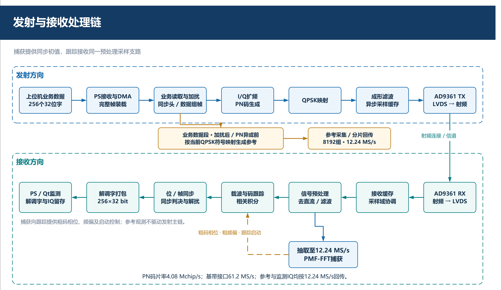

### 2.3 发射处理原理

上位机向板卡提交 256 个 32 位业务字。PS 接收完整业务帧后写入 DDR，再通过 DMA 装载到 PL 的业务暂存区。数据完整装载后，发射链依次执行业务读取、加扰、同步头与数据段组帧、PN 扩频、QPSK 映射和成形滤波，最终形成数字 I/Q 样本，通过 LVDS 送入 AD9361 完成数模转换、上变频和射频发射。

系统同步头为 112 bit，每位对应 1020 个码片；数据段包含 4096 个 I/Q 符号，每个符号对应 51 个码片。在 4.08 Mchip/s 码片率下，同步头持续约 28 ms，数据段持续约 51.2 ms，理想单帧时长约 79.2 ms。发射端另从数据段加扰后、PN 异或前引出参考观测支路，采集 8192 组 I/Q 数据，用于观察扩频前后的频谱形态，但该支路不参与发射控制。

### 2.4 接收捕获与跟踪原理

AD9361 输出的接收 I/Q 首先完成直流抑制、滤波和功率检测，随后分为捕获与跟踪两条支路。捕获支路使用 12.24 MS/s 抽取数据，在码相位和载波频偏未知的情况下执行 PMF-FFT 搜索；跟踪支路使用预处理后的 61.2 MS/s 数据，根据捕获结果修正残余频偏、相位和码定时误差。

PMF-FFT 捕获采用 20 路复数分段相关。每段相关积分 612 个采样点，每个候选码相位形成 5 个复数结果，结果补零后送入 128 点复数 FFT，计算功率并搜索峰值。捕获相干积分设置为 250 μs。峰值所在的相关支路和处理批次映射为粗码相位，FFT 频率索引映射为粗频偏。捕获通过门限后，控制逻辑将粗码相位、粗频偏及启动时刻转换为载波 NCO 和码 NCO 初值，清除旧积分状态并启动跟踪。

载波跟踪使用及时支路相关结果提取相位误差，经过环路滤波后更新载波 NCO；码跟踪比较超前与滞后支路的相关幅度，形成码误差并更新码 NCO。同步稳定后，及时支路进入帧同步、判决和解扰处理，得到业务数据。

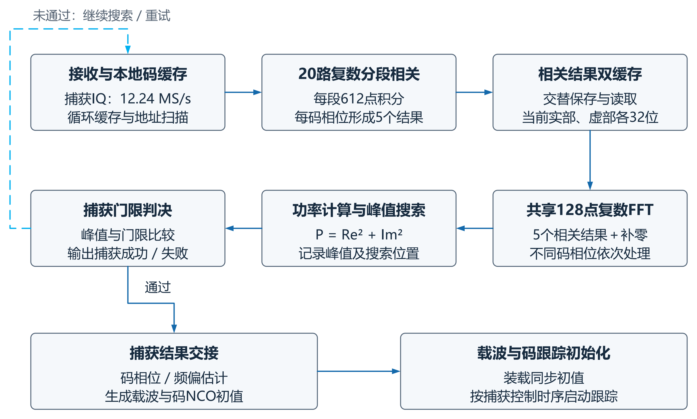

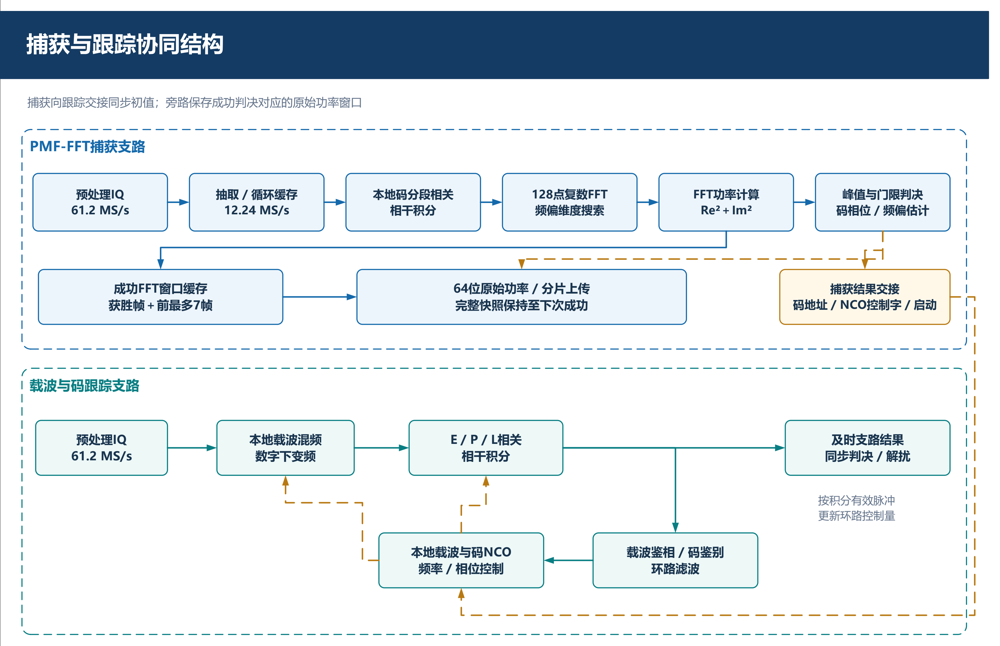

### 2.5 主要设计参数

| 参数 | 当前配置 |
|---|---:|
| 收发本振频率 | 1.5 GHz |
| AD9361 数字接口采样率 | 61.2 MS/s |
| 射频带宽 | 20 MHz |
| 接收增益 | 21 dB |
| 发射衰减 | 20 dB |
| PN 码片率 | 4.08 Mchip/s |
| 捕获支路有效采样率 | 12.24 MS/s |
| 捕获相干积分窗口 | 250 μs |
| 每段相关积分长度 | 612 个采样点 |
| 每个码相位的分段相关结果 | 5 个复数结果 |
| 捕获 FFT 长度 | 128 点 |

## 3 软硬件划分依据与接口设计

### 3.1 软硬件划分依据

系统按照实时性、并行度、控制复杂度和数据展示需求划分任务。PL 负责与采样节拍直接相关且需要并行运算的基带处理；PS 负责低速配置、存储管理和网络协议；AD9361 负责模拟射频与数字 I/Q 之间的转换；Qt 上位机负责交互、频谱计算和数据留存。

| 组成部分 | 主要任务 | 划分依据 |
|---|---|---|
| AD9361 | ADC DAC 上下变频 频率带宽增益配置 | 射频与高速数据转换由专用收发器完成 |
| Zynq PL | 组帧 加扰 扩频 调制 预处理 PMF-FFT捕获 载波与码跟踪 解调 监测采样 | 运算受连续采样节拍约束，需要确定时延和并行处理能力 |
| Zynq PS | AD9361初始化 DDR缓存 DMA调度 业务协议与监测协议 TCP通信 | 控制流程复杂、配置变化频率低，适合软件管理 |
| Qt上位机 | 业务编辑与发送 网络帧重组 波形频谱与捕获结果显示 数据核对和保存 | 人机交互和浮点分析不要求与采样时钟逐周期同步 |

下图给出系统采用的 Zynq 与 AD9361 硬件平台，以及 Vivado 工程中 PS、DMA、存储与 PL 数据通路之间的连接关系。

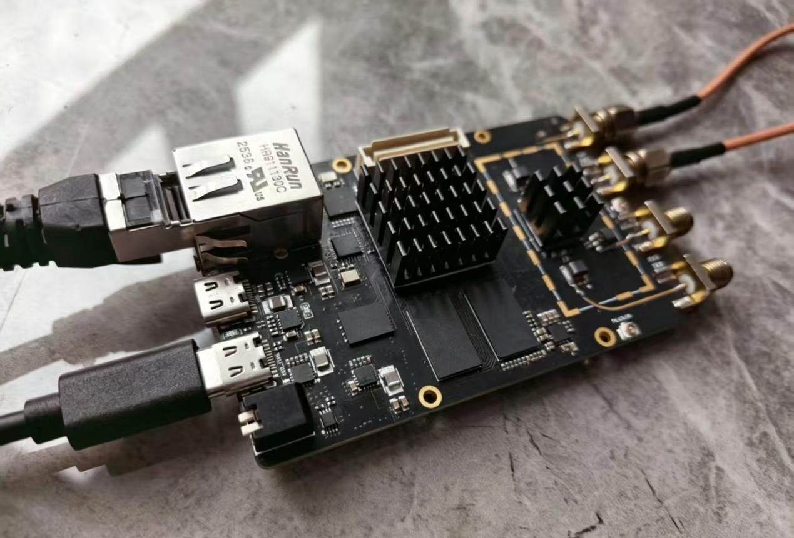

#### 系统联调环境实物

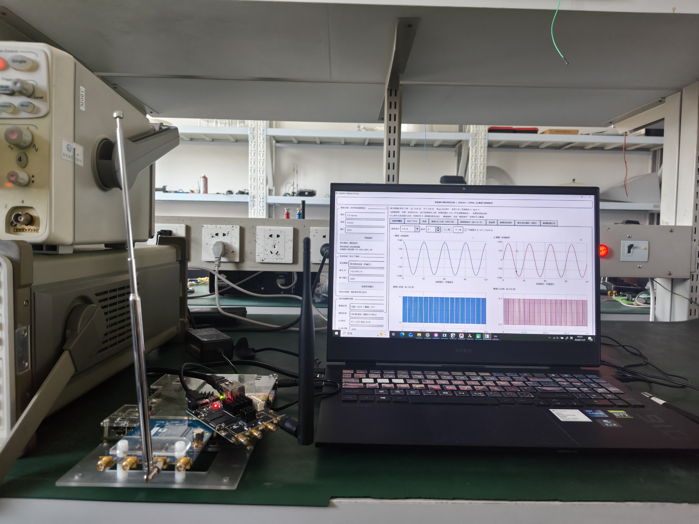

照片展示了 Zynq 与 AD9361 板卡、射频天线、电脑及 Qt 上位机组成的现场联调环境。板卡与电脑配合，用于业务配置、监测数据显示及链路观察。照片说明设备摆放与操作环境，具体工作模式、射频参数和业务恢复情况应结合本次日志与原始数据确认。

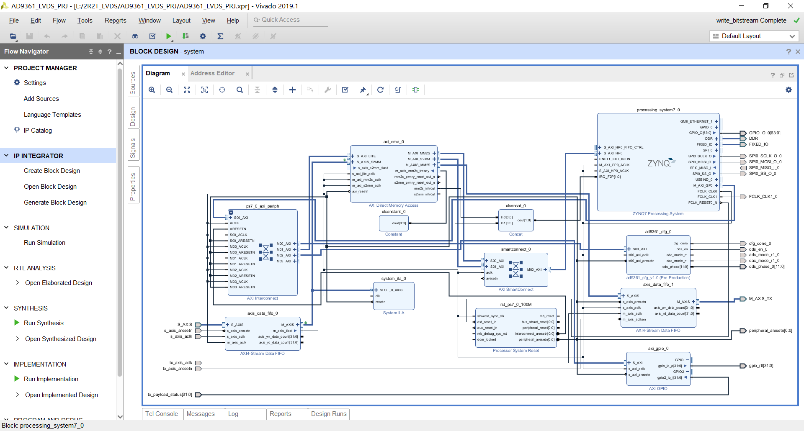

### 3.2 AD9361 与 PL 接口

AD9361 与 PL 之间采用 LVDS 数字接口传输 I/Q 数据和配套时序信号，接口有效采样率为 61.2 MS/s。高速采样数据与低速配置控制分开管理，射频工作频率、带宽、增益和运行状态由 PS 侧初始化流程配置。PL 侧完成 LVDS 数据收发、DDR 边沿转换以及 I/Q 数据整理，使后级基带模块获得统一的并行数据格式。

### 3.3 PS 与 PL 接口

业务数据由 PS 通过 TCP 接收后写入 DDR，再使用 DMA 送入 PL 发射缓存；监测数据由 PL 按固定结构打包，经 DMA 写入 DDR 后由 PS 读取并发送。PS 与 PL 之间使用存储访问和流式数据接口，并通过长度、有效标志和握手信号明确数据边界。

不同工作时钟域之间采用异步缓存协调读写节拍，跨域控制信号进行同步处理。缓存用于吸收短时传输波动，但系统持续吞吐能力仍由 DMA、处理器和网络的平均处理速率决定。

### 3.4 网络与监测协议

系统使用两条独立 TCP 连接。电脑作为 TCP Server 监听 5001 端口，接收板卡主动上传的监测数据；板卡在 5002 端口提供业务接收服务，上位机主动连接并下发业务帧。业务与监测分离可以避免大块监测数据阻塞业务控制。

MONI type5 监测包总长 5136 B，由 16 B 帧头和 5120 B 载荷组成。载荷固定包含 4096 B 接收 I/Q 区和 1024 B 附加区。附加区按标志互斥承载完整解调字、SPR1 扩频前参考分片或 FFW1 捕获功率窗口分片。帧头多字节字段采用网络字节序，载荷保持小端格式；每个 I/Q 字的低 16 位为 I，高 16 位为 Q，均按有符号数解释。

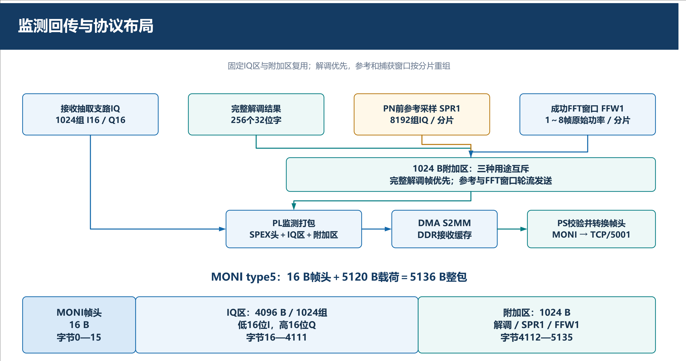

### 3.5 Qt 上位机显示与数据处理

Qt 上位机在接收线程中完成 TCP 字节流重组、MONI 帧校验和附加区分片重组，界面线程约每 100 ms 读取一次最新快照。接收 I/Q、扩频前参考、完整解调字和成功捕获窗口分别管理，避免把同一个监测包中来自不同采集时刻的数据误认为同一无线帧。

主频谱页面比较发射端 PN 异或前参考和接收端尚未解扩的 I/Q。参考数据采用 4096 点分段，接收数据采用 128 点分段进行 Welch 功率谱估计，并对接收功率进行多组平均。捕获页面只在完整成功窗口重组完成后更新，随后保持至下一次完整结果到达。

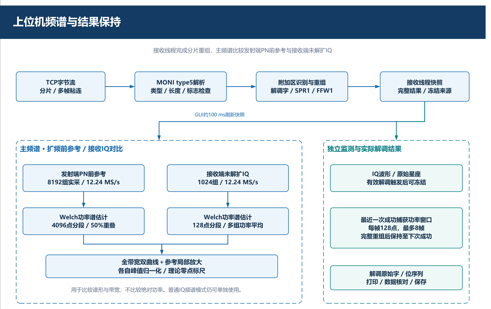

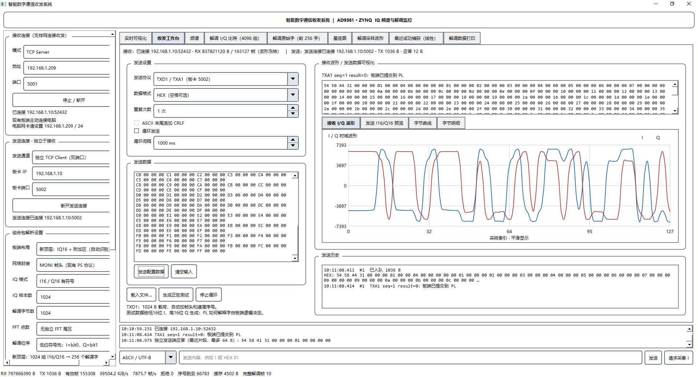

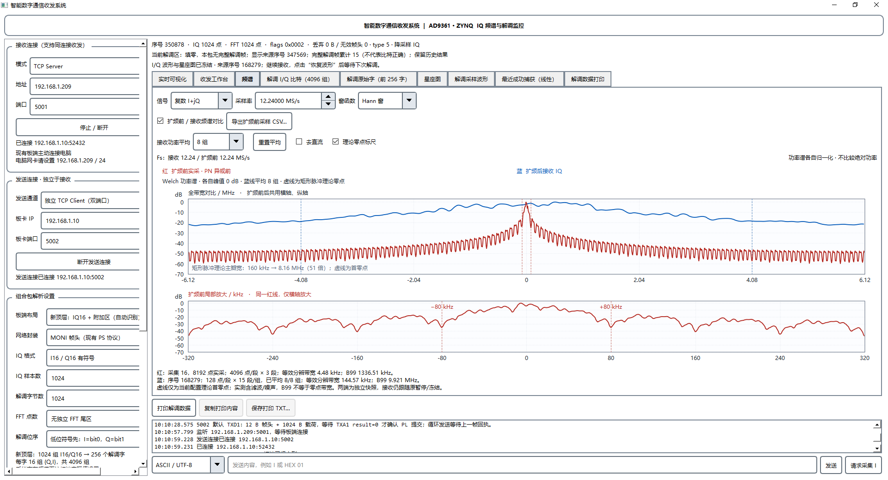

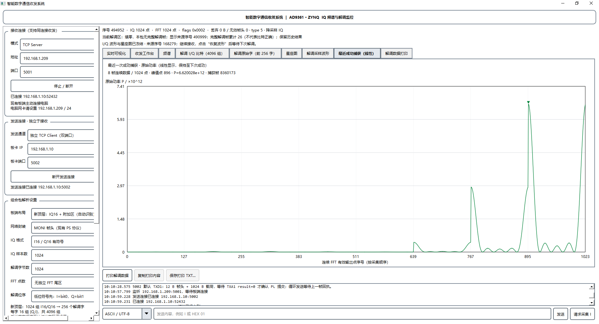

#### I/Q 与解调比特显示（演示模式）

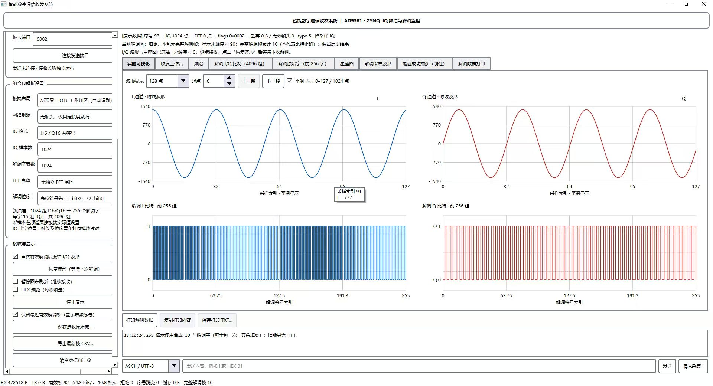

界面上方分别显示 I、Q 两路时域波形，下方显示解调 I、Q 比特序列；左侧提供布局解析、I/Q 格式、样本数及波形冻结等设置。该图用于说明上位机对模拟量波形、二值序列和解调触发冻结的展示方式。

截图日志明确标注使用合成 I/Q 与解调字，因此该图为界面演示，不作为真实射频接收、捕获成功或业务无误恢复的测试证据。实际链路验证仍需结合发送文件、TXA1 回执、MONI 原始数据及解调字逐项核对。

## 4 优化过程及性能与资源对比

### 4.1 优化目标与基线结构

捕获模块需要同时覆盖多个码相位并搜索载波频偏。若为 20 路复数相关通道分别配置独立 128 点 FFT 核，能够保持较高并行度，但 LUT、寄存器、BRAM 和 DSP 开销会接近单核资源的 20 倍。若完全改为串行相关，又会降低同一批次的码相位处理能力。因此，优化目标是在保留 20 路相关并行度和 128 点频域搜索能力的前提下，减少重复 FFT、缓存和乘法资源。

### 4.2 优化措施

1. **并行相关与分批搜索结合。** 20 路复数相关通道同时处理一组候选码相位，较大搜索范围通过调整缓存读取地址和搜索计数分批完成，使相关通道能够重复使用。
2. **多个码相位共享一个 FFT 核。** 分段相关结果先写入双缓存，再按码相位顺序送入同一个 128 点 FFT 核。双缓存使当前批次写入与上一批次读取能够衔接。
3. **利用 PN 码二值特性。** 本地 PN 码仅对应输入取正或取负，因此相关乘码由受控加减累加实现，不为该环节配置通用乘法器。
4. **按数值范围确定定点位宽。** 16 位输入在 612 点积分下需要 26 位有符号累加范围。相关缓存将实部、虚部由各 32 位压缩为各 26 位，读取时再符号扩展到 32 位 FFT 输入接口。
5. **捕获主链与监测支路分离。** 成功捕获功率窗口通过旁路缓存保存，监测逻辑只读取 FFT 功率、索引和成功标志，不改变原捕获门限及反馈条件。

### 4.3 结构与性能保持对比

| 对比项目 | 优化前等效基线 | 优化后 | 结果 |
|---|---:|---:|---|
| 复数相关通道数 | 20 路 | 20 路 | 搜索并行度保持不变 |
| FFT 核数量 | 20 个 | 1 个共享核 | 减少 95% |
| 每路 FFT 长度 | 128 点 | 128 点 | 频域点数保持不变 |
| 每个实部或虚部缓存位宽 | 32 bit | 26 bit | 各减少 6 bit |
| 每个复数缓存字 | 64 bit | 52 bit | 减少 12 bit |
| 两组缓存复数数据总数 | 200 个 | 200 个 | 缓存深度保持不变 |
| 相关结果逻辑存储量 | 12800 bit | 10400 bit | 减少 2400 bit 约 18.75% |
| FFT 输入接口 | 实部虚部各 32 位 | 符号扩展后各 32 位 | 后级接口保持不变 |

该优化没有减少相关通道数量，也没有降低 FFT 长度。处理方式由“所有码相位同时占用独立 FFT”改为“相关并行、FFT 分时”，代价是增加缓存调度与批次控制，因此设计时必须保证每次缓存换组前完成对应 FFT 处理。

### 4.4 FFT 计算资源对比

| FFT 部分资源 | 优化前 20 个相同 FFT 核 | 优化后 1 个共享 FFT 核 | 减少量 |
|---|---:|---:|---:|
| LUT | 64620 | 3231 | 61389 约 95% |
| 寄存器 | 107260 | 5363 | 101897 约 95% |
| BRAM Tile | 20 | 1 | 19 约 95% |
| DSP | 480 | 24 | 456 约 95% |

上述“优化前”是按 20 个相同 FFT 核构成的等效基线估算，用于评价共享 FFT 的结构收益；它不是另一套完整系统的板级实测结果。共享设计使 FFT 部分的主要计算资源约减少 95%，相关结果缓存逻辑存储量减少 18.75%，同时保留 20 路相关和 128 点 FFT 的核心处理规格。

下图为 Vivado 工程资源利用情况，可用于核对优化后完整设计在目标器件上的总体资源分布。表中的 FFT 对比用于解释共享计算单元带来的局部收益，完整工程资源图则反映其与其他发射、接收、跟踪和接口模块共同实现后的整体占用。

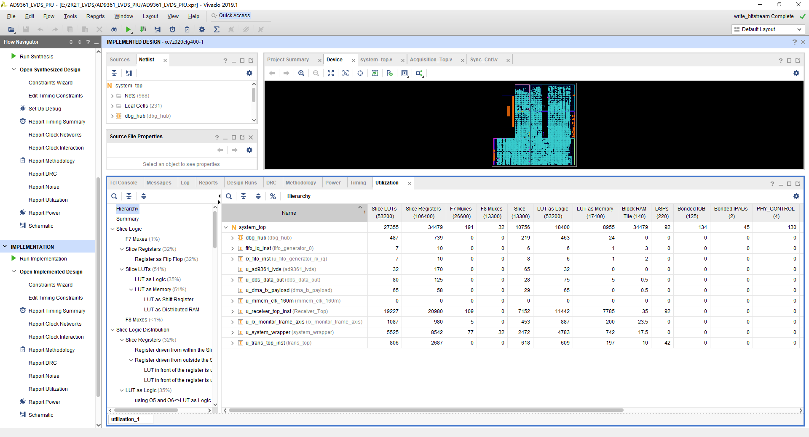

## 5 结论

本设计通过 Zynq PS PL 协同和 AD9361 射频收发，完成扩频通信的业务下发、实时基带、初始捕获、持续跟踪、解调回传和上位机监测。系统把实时并行任务、控制管理任务和人机分析任务分配到合适的平台，并通过 LVDS、DMA、DDR 和双 TCP 连接建立清晰的数据边界。

捕获模块采用 20 路复数相关与单个共享 FFT 相结合的结构，在保持搜索并行度和频域点数的同时，显著降低 FFT 计算资源和缓存位宽。多源监测与成功捕获窗口保持进一步提高了系统可观察性，为参数调整、故障定位和后续误码率及射频性能测试提供了工程基础。

## 参考文献

1. DIXON R C. *Spread Spectrum Systems with Commercial Applications*. 3rd ed. John Wiley & Sons, 1994.
2. GARDNER F M. *Phaselock Techniques*. 3rd ed. John Wiley & Sons, 2005.
3. COOLEY J W, TUKEY J W. An algorithm for the machine calculation of complex Fourier series. *Mathematics of Computation*, 1965, 19(90): 297-301.
4. VAN NEE D J R, COENEN A J R M. New fast GPS code-acquisition technique using FFT. *Electronics Letters*, 1991, 27(2): 158-160.
5. AKOPIAN D. Fast FFT based GPS satellite acquisition methods. *IEE Proceedings Radar Sonar and Navigation*, 2005, 152(4): 277-286.
6. XILINX. *Vivado Design Suite User Guide Synthesis UG901*. Version 2019.1, 2019.

## 6复现说明

###一、操作前准备

1. 确认ZYNQ、AD9361和电脑之间已经正确连接。
2. 给ZYNQ和AD9361上电。
3. 确认FPGA位流已经下载，板端程序已经启动。
4. 使用网线连接电脑与板卡，或者将二者连接到同一交换机。

###二、设置电脑网卡

将连接开发板的电脑有线网卡设置为静态IPv4地址：

电脑IP地址：192.168.1.209
子网掩码：255.255.255.0
默认网关：留空
DNS服务器：留空

板卡默认网络参数：

板卡IP地址：192.168.1.10
监测数据端口：5001
业务下发端口：5002

设置完成后，可以先测试：

ping 192.168.1.10

如果无法ping通，应先检查网线、电脑网卡地址、板端程序和lwIP初始化状态。

###三、启动Qt上位机

1. 双击运行Qt上位机程序。
2. 等待主界面完全打开。
3. 检查界面日志区域是否出现网络参数和协议说明。

###四、建立监测数据连接（TCP 5001）

在上位机的监测接收区域设置：

工作模式：Server
监听地址：0.0.0.0
监听端口：5001

操作步骤：

1. 选择Server模式。
2. 地址填写0.0.0.0。
3. 端口填写5001。
4. 单击“开始监听”。
5. 等待板卡主动连接电脑。

连接成功后，上位机应显示监测端口已经连接，接收帧计数开始增加。

建议先启动上位机的5001监听，再启动或复位板端程序，便于板卡成功连接电脑。

###五、建立业务下发连接（TCP 5002）

在上位机的数据发送区域设置：

连接方式：独立TCP Client（双端口）
发送地址：192.168.1.10
发送端口：5002
发送协议：TXD1/TXA1（板卡5002）

操作步骤：

1. 选择“独立TCP Client（双端口）”。
2. 板卡地址填写192.168.1.10。
3. 发送端口填写5002。
4. 发送协议选择“TXD1/TXA1”。
5. 单击“连接发送端口”。
6. 等待界面显示发送端口已经连接。

5001和5002是两条相互独立的TCP连接：

5001用于板卡向电脑回传监测数据。
5002用于电脑向板卡下发业务数据并接收TXA1回执。

###六、准备发送数据

每次发送的业务载荷固定为：

载荷长度：1024字节
数据数量：256个32位字

推荐使用测试文件：

sim\test_data\sine\sine_tx_payload.bin

如果测试文件尚未生成，可在仓库根目录执行：

python sim\tools\generate_sine_data.py

生成后的测试数据位于：

sim\test_data\sine

其中：

sine_tx_payload.bin：1024字节业务载荷，推荐在Qt中载入。
sine_txd1.bin：1036字节完整TXD1请求帧，已经包含12字节帧头。

使用新版Qt上位机时，推荐载入sine_tx_payload.bin，由Qt自动添加TXD1帧头和发送序。

###七、单次下发数据

1. 进入上位机的数据发送页面。
2. 单击“载入文件”或对应的数据选择按钮。
3. 选择sine_tx_payload.bin或其他1024字节业务文件。
4. 检查界面显示的载荷长度是否为1024字节。
5. 确认发送协议为TXD1/TXA1。
6. 确认板卡5002端口仍处于连接状态。
7. 单击“单次发送”。
8. 等待板卡返回TXA1回执。

Qt发送时会自动形成以下请求帧：

4字节“TXD1”标志
+ 4字节发送序号
+ 4字节载荷长度
+ 1024字节业务载荷
= 1036字节完整请求帧

###八、检查发送回执

发送后观察上位机日志。

发送成功时应显示：

TXA1 result=0

该结果表示：

1. 板卡已经收到完整的1024字节业务载荷。
2. 板卡已经检查TXD1帧头、序号和长度。
3. AXI DMA已经完成MM2S传输。
4. 完整业务帧已经提交到PL暂存区。

需要注意：TXA1 result=0只表示数据已经成功提交给PL，不表示无线接收端已经完成捕获和解调。无线链路结果还需要通过5001监测数据进行确认。

如果返回非0结果，或者6秒内没有回执，应检查：

1. 发送文件是否正好为1024字节。
2. Qt是否选择TXD1/TXA1协议。
3. 板卡5002端口是否正常连接。
4. 板端payload TCP服务是否成功启动。
5. AXI DMA MM2S是否忙或出现错误。
6. PL侧AXI4-Stream ready/valid握手是否正常。

###九、启动循环发送

单次发送成功后，再进行循环发送：

1. 设置循环发送间隔或发送次数。
2. 单击“循环发送”。
3. 上位机每发送一帧后等待对应的TXA1回执。
4. 收到result=0后再发送下一帧。
5. 观察发送序号是否连续增加。
6. 如果出现板端错误或回执超时，应立即停止循环发送并排查问题。

###十、观察接收与处理结果

业务数据下发后，在Qt上位机中依次观察：

1. 网络状态
   确认5001监测连接和5002发送连接均保持正常。

2. 接收帧计数
   确认MONI监测帧序号持续增加，没有大量丢帧或乱序提示。

3. I/Q波形
   检查接收I/Q是否存在有效信号，是否出现削顶、直流偏置或明显异常。

4. 接收频谱
   检查扩频信号频谱形态、中心频率和带宽是否合理。

5. PMF-FFT捕获结果
   检查相关峰值是否超过门限，码相位和频偏索引是否稳定。

6. 载波与码跟踪状态
   检查FLL、PLL和DLL是否进入稳定跟踪状态。

7. 解调数据
   检查同步头、解调符号和恢复业务数据是否正确。

8. 发射参考数据
   对比发射端PN异或前参考与接收端信号的波形或频谱。

###十一、保存测试结果

完成一次测试后，建议保存：

1. Qt运行日志。
2. 发送文件名称和文件长度。
3. TXD1发送序号和TXA1回执结果。
4. 接收I/Q波形截图。
5. 接收频谱截图。
6. PMF-FFT捕获峰值截图。
7. 载波和码跟踪结果。
8. 解调数据或符号结果。
9. 本次测试使用的本振频率、带宽、增益和发射衰减。
10. 测试时间及异常情况说明。

###十二、操作成功判定

同时满足以下条件时，可认为上位机数据下发和结果回传流程正常：

1. Qt成功监听0.0.0.0:5001。
2. 板卡成功连接电脑5001端口。
3. Qt成功连接板卡192.168.1.10:5002。
4. 1024字节业务文件能够正常载入。
5. 单次发送后收到TXA1 result=0。
6. 循环发送时序号连续，回执正常。
7. Qt能够持续接收MONI监测帧。
8. I/Q波形和频谱能够正常显示。
9. PMF-FFT捕获页面能够显示有效结果。
10. 跟踪和解调结果能够显示并保存。